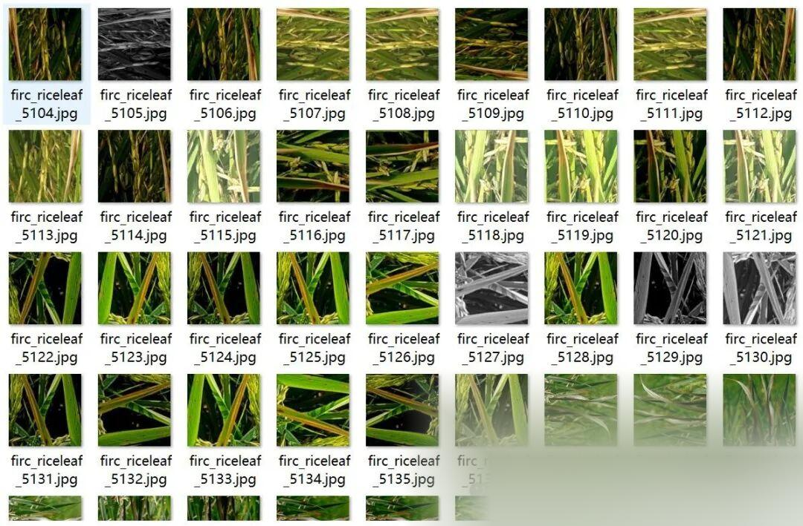
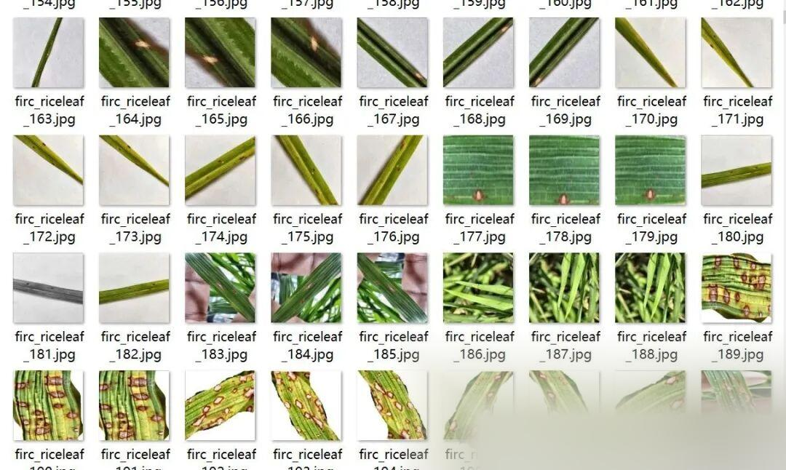
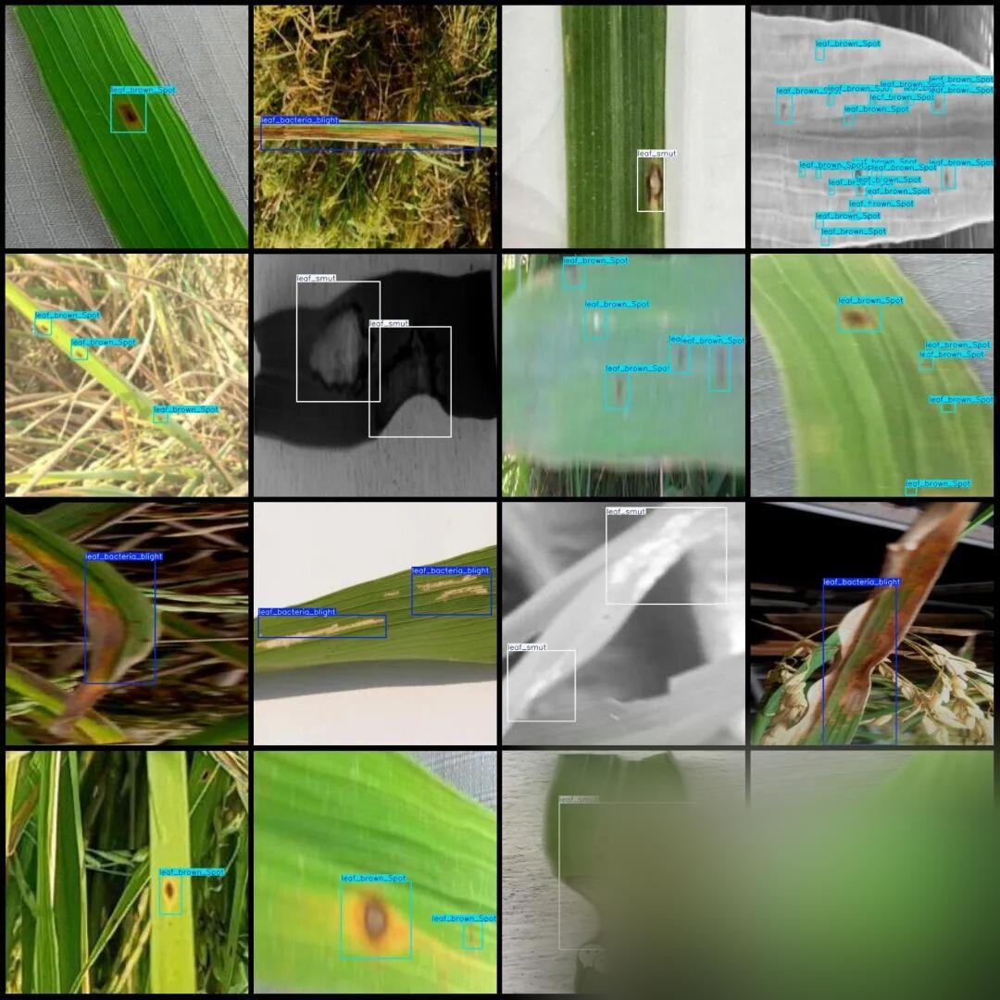

# Rice leaf disease detection dataset VOC+YOLO format with 6138 images in 3 categories

Dataset format: Pascal VOC format + YOLO format (txt file without split path, only containing jpg images and corresponding VOC format xml files and yolo format txt files)

Number of images (number of jpg files): 6138

Number of annotations (number of xml files): 6138

Number of annotations (number of txt files): 6138

Label category count: 3

Label category names (note that the order of categories in the YOLO format does not correspond to this, but is based on the labels folder's classes.txt): ["leaf_bacteria_blight", "leaf_brown_Spot", "leaf_smut"]

Number of boxes labeled in each category:

leaf_bacteria_blight frame count = 2955

leaf_brown_Spot Frames = 13063

Leaf Smut Frames = 6380

Total frame count: 22398

Using labelImg:

Annotation rules: Draw a rectangle around the category.

Important Notice: No

Special : This dataset does not guarantee the accuracy or precision of the trained models or weight files. The dataset is provided with accurate and reasonable annotations only.

Image Preview:

Annotation Examples (randomly select 16 images for display):

## Payment

Here is a pay link on Stripe ( https://buy.stripe.com/3cs8yP7sY87d0vu9AB ). Please contact me lonlonago@foxmail.com after funding $89, and I will send you a complete data files , thank you!

